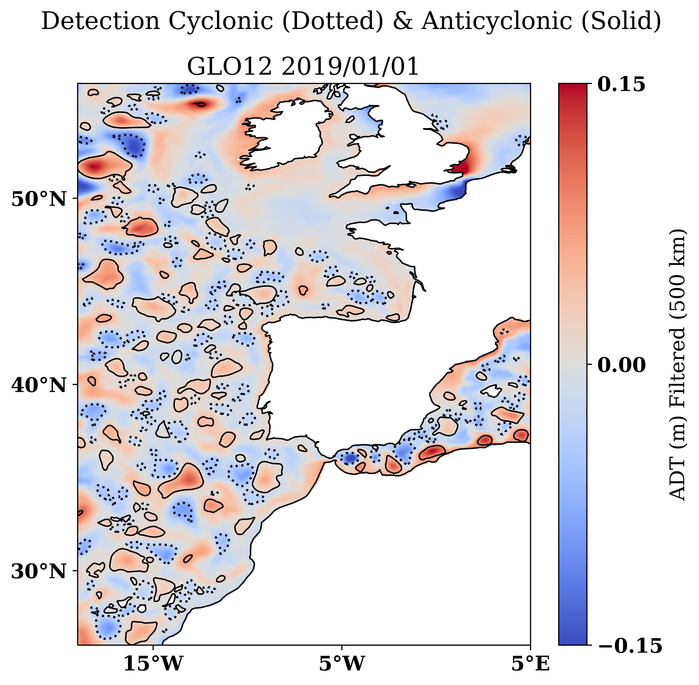

# Eddy-Tracking-Intercomparison 

```
cd existing_repo
git remote add origin https://gitlab.mercator-ocean.fr/fdubost/eddy-tracking-intercomparison.git
git branch -M main
git push -uf origin main
```

## Description

This project uses the py-eddy-tracker tool to detect and track eddies. Is also included the comparison between models or model and observations with a regional approach. 

## Installation

Locally one can load the following conda environment: /data/rd_exchange/svangennip/PYTHON/ENVS/env_PET_dev 

The version of py-eddy-tracker used here is adapted from https://py-eddy-tracker.readthedocs.io/en/stable/
and available in https://github.com/svangennip/py-eddy-tracker

Alternatively one can create its own environment as follows:
```sh
conda create env_PET_dev python=3.8
conda activate env_PET_dev
```
Retrieve modified py-eddy-tracker and install it in your activated enironment
```sh
git clone git@github.com:svangennip/py-eddy-tracker.git 
python setup.py install
```
conda install install numpy scipy netCDF4 matplotlib opencv-python pyyaml pint polygon3 pandas scikit-image xarray cmocean cartopy
!! Need to change version f numpy to <1.21
***

# Usage

When you're ready to make this README your own, just edit this file and use the handy template below (or feel free to structure it however you want - this is just a starting point!). Thank you to [makeareadme.com](https://www.makeareadme.com/) for this template.

## 1. Preprocessing the data (/PREPROCESS): extract the region and variables needed for the study

 - create a text file containing the paths to all daily files of the period of study:
```sh
find /sortref/opr/duglo-2/nrt/psy4v3r1/global-analysis-forecast-phy-001-024/ -type f -name "mercatorpsy4v3r1_gl12_mean_2021*.nc" | sort > List_PSY4V3R1_2021.txt
```
- create nc files containing only wanted regions and variables (zos,uo,vo,so,thetao ) for surface vales
```sh
bash Extract_region_vars_PSY3V3R1.sh
```
requires editing for specifying inout and output locations
## 2. Detect Eddies 

Once all daily files with surface velocities and SSH for the region of interest are in one repository you can procceed to the identification. 

Modify the Config_Detect.ini file for detection parameters, variables & input and output directories.
```sh
python Detect_Eddies.py Config_Detect.ini
```


## 3. Track Eddies

Use overlap method to track eddies in space and time. 
```sh
bash track_eddies.bash 
```
Produces 8 files (4 for AC and 4 for CC) :
```sh
- Anticyclonic.nc
- Anticyclonic_correspondances.nc
- Anticyclonic_track_too_short.nc
- Anticyclonic_untraked.nc
```

Idem for cyclonic eddies. 

***

# Analysis 
Here we present an initiative for putting in place a multi-metric validation platform for the comparison of ocean currents. The purpose of this analysis is to make a comparison between a model and a reference. This reference can be another model or a product of observations. 
The previous detection and tracking steps must have been performed on both datasets before proceeding. 

Note that it is possible to use only part of the code for a single dataset eddy landscape study. 

- In the Config_Analysis.ini : edit parameters, geographical domain, repositories and plot info

```sh
 python Analysis_Eddy_1model.py Config_Analysis.ini
```

The output shoul look like this : 



