# Eddy-Tracking-Intercomparison 

```
cd existing_repo
git remote add origin https://gitlab.mercator-ocean.fr/fdubost/eddy-tracking-intercomparison.git
git branch -M main
git push -uf origin main
```

## Description 

This project uses the py-eddy-tracker tool to detect and track eddies  :cyclone:
. Is also included the comparison between models or model and observations with a regional approach.

## Installation

Locally one can load the following conda environment: /data/rd_exchange/svangennip/PYTHON/ENVS/env_PET_dev 

The version of py-eddy-tracker used here is adapted from https://py-eddy-tracker.readthedocs.io/en/stable/
and available in https://github.com/svangennip/py-eddy-tracker

Alternatively one can create its own environment as follows:
```sh
conda create env_eddy python=3.8
conda activate env_eddy
```
Retrieve modified py-eddy-tracker and install it in your activated enironment
```sh
git clone git@github.com:svangennip/py-eddy-tracker.git 
python setup.py install
pip install pyeddytracker
```
conda install install numpy scipy netCDF4 matplotlib pyyaml pint polygon3 pandas scikit-image xarray cmocean cartopy

***

Or one can use the env.yaml file available

```sh
conda env create -f env.yaml 

```
Clone the git project after the activation of the environnement.
# Usage

## 0. General workflow 

<div align="center">
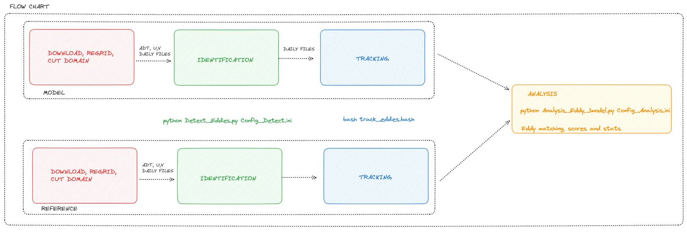
</div>


## 1. Preprocessing the data (/PREPROCESS): extract the region and variables needed for the study


- If you work in a local environnement with data already stocked you can manually change the units (m/s) or interpolate on a regular grid. 

- Or you can use the following prodedure (here one exemple) : 
 
1.  Create a text file containing the paths to all daily files of the period of study:
```sh
find /sortref/opr/duglo-2/nrt/psy4v3r1/global-analysis-forecast-phy-001-024/ -type f -name "mercatorpsy4v3r1_gl12_mean_2021*.nc" | sort > List_PSY4V3R1_2021.txt
```

2. Create nc files containing only wanted regions and variables (zos,uo,vo) for surface vales
```sh
bash Extract_region_vars_PSY3V3R1.sh
```
requires editing for specifying input and output locations

All 3 variables must be on a regular grid with one netcdf file per day. The units for the current velocities must be "m/s" or no detection can be performed.

## 2. Detect Eddies 

Once all daily files with surface velocities and SSH for the region of interest are in one repository you can procceed to the identification. 

Edit the Config_Detect.ini file for detection parameters, variables & input and output directories.
```sh
python Detect_Eddies.py Config_Detect.ini
```


## 3. Track Eddies

Use overlap method to track eddies in space and time. 
```sh
bash track_eddies.bash 
```
Produces 8 files (4 for AC and 4 for CC) :
```sh
- Anticyclonic.nc
- Anticyclonic_correspondances.nc
- Anticyclonic_track_too_short.nc
- Anticyclonic_untraked.nc
```

Idem for cyclonic eddies. 

***

# Analysis 
Here we present an initiative for putting in place a multi-metric validation platform for the comparison of ocean currents. The purpose of this analysis is to make a comparison between a model and a reference. This reference can be another model or a product of observations. 
The previous detection and tracking steps must have been performed on both datasets before proceeding. 

Note that it is possible to use only part of the code for a single dataset eddy landscape study. 

- In the Config_Analysis.ini : edit parameters, geographical domain, repositories and plot info

```sh
 python Analysis_Eddy_1model.py Config_Analysis.ini
```

The output shoul look like this : 
Here the example is the study of the GLO12V4 Mercator product for the IBI area for the year 2019. The reference used is AVISO at the 1/8° resolution. 


- Detection for one day with ADT 
<div align="center">

</div>


- Cyclonic and Anticyclonic tracks 
<div align="center">
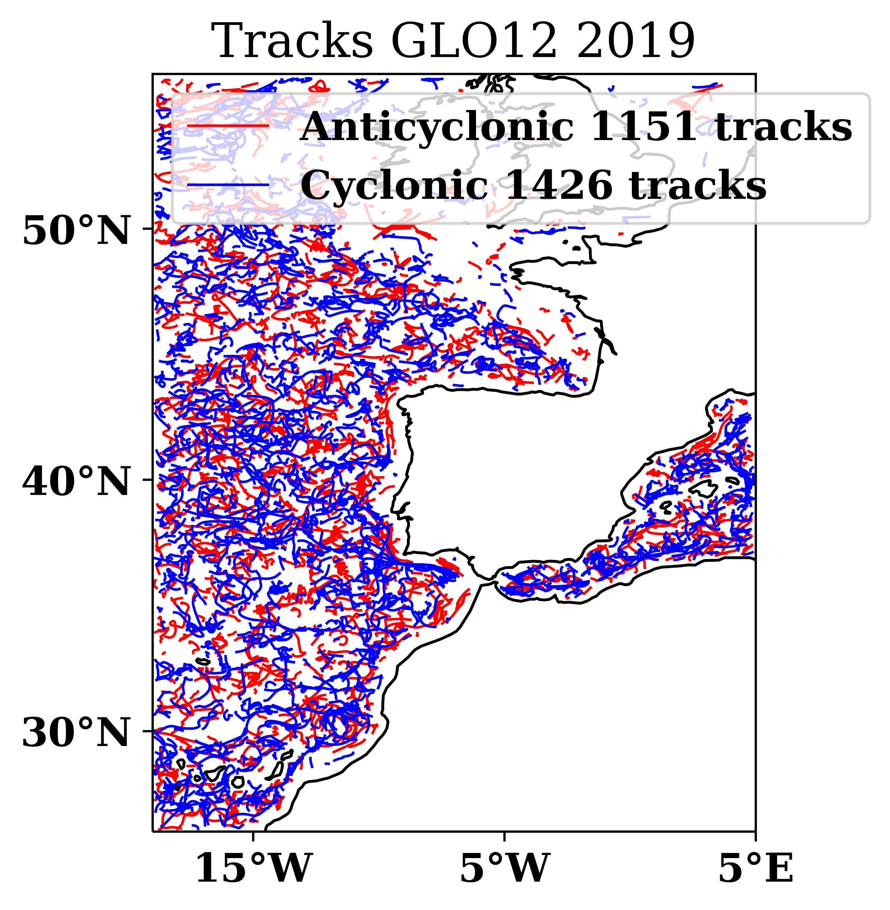
</div>

- Number of eddies by days by 1°*1° cells
<div align="center">
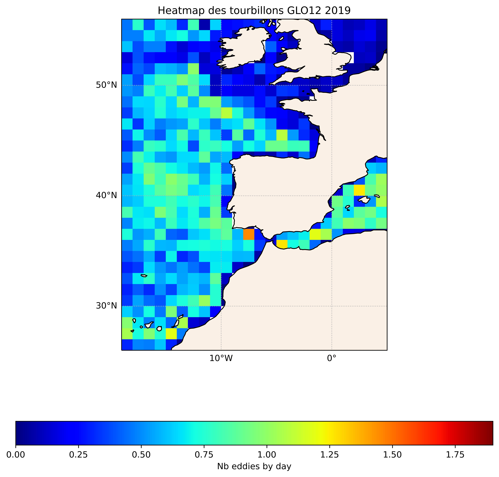
</div>

- Mean radius of eddies by 1°*1° cells
<div align="center">
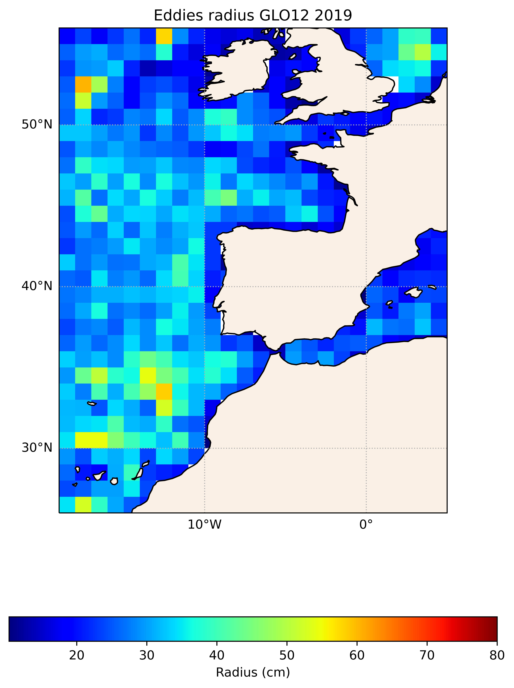
</div>

- Number of eddies detected through time
<div align="center">
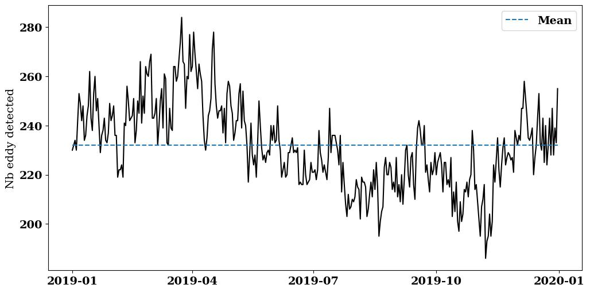
</div>

- Histogram 2D Amplitude VS Radius 
<div align="center">
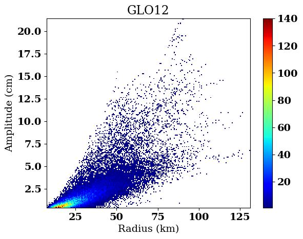
</div>

- Amplitude for the model and the altimetry reference 
<div align="center">
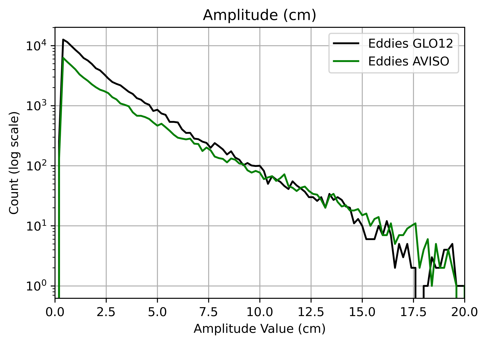
</div>

- Eddies lifetime for the model and the altimetry reference 
<div align="center">
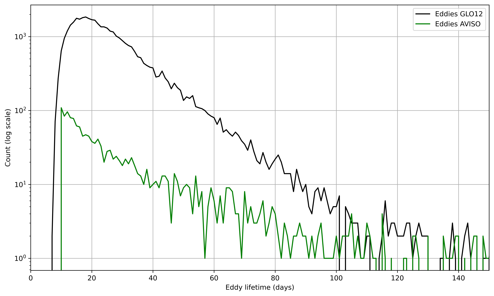
</div>

- Speed Radius for the model and the altimetry reference 
<div align="center">
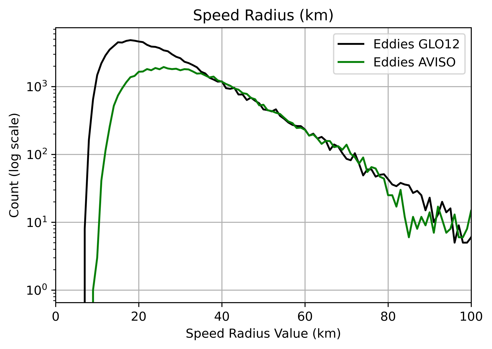
</div>

RESULTS MATCHING 

- Histogram hits, misses & false alarms by radius (km)
<div align="center">
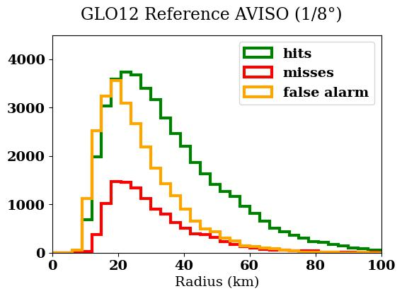
</div>

- Evolution of POD and FAR with amplitude (cm)
<div align="center">
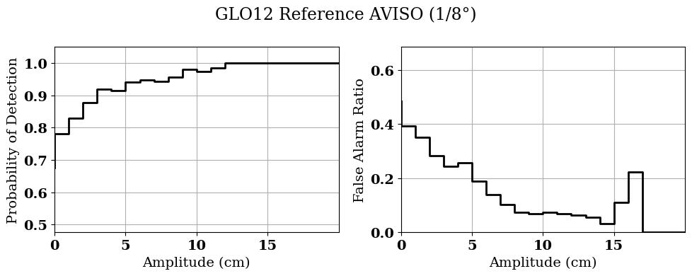
</div>

- Evolution of POD and FAR with time
<div align="center">
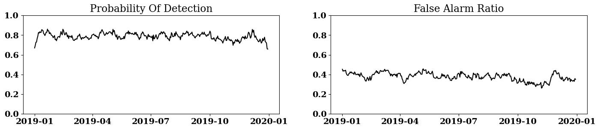
</div>

- Performance Diagram 
<div align="center">
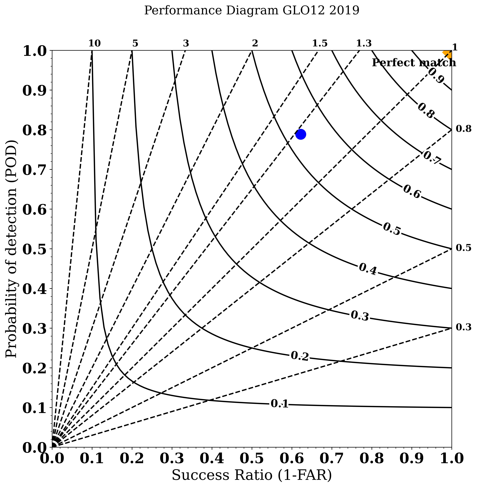 
</div>


